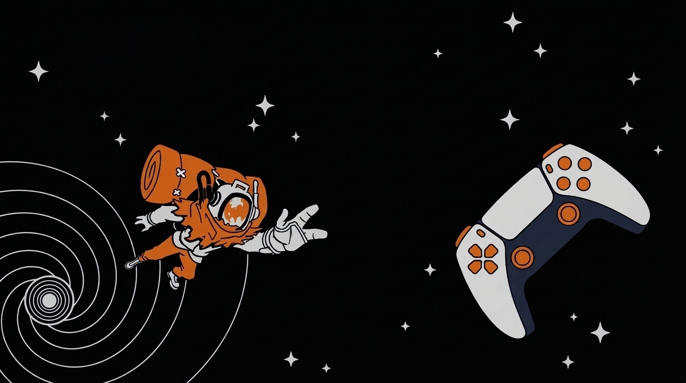

Logo by <a href="https://www.reddit.com/user/young_historic">u/young_historic</a>

# OuterWilds-Dualsense

**English** | [Русский](README.ru.md)

A DualSense mod for **Outer Wilds** (via [OWML](https://github.com/ow-mods/owml)): real haptic feedback through the controller's audio channels, adaptive triggers, a lightbar that follows the planet you are on, touchpad controls and gyro steering.

> This work is unofficial Fan Content created under permission from the Mobius Digital Fan Content Policy. It includes materials which are the property of Mobius Digital and it is neither approved nor endorsed by Mobius Digital.

## Features

- **Haptic feedback**: almost every sound of the game that you can feel is turned into haptics: the jetpack and the ship's engines, footsteps, jumps and landings, impacts and damage, hazards, water, machinery, doors and lifts, the environments of the planets and much more. The whole Solar System and the **Echoes of the Eye** DLC are covered. Music is left out, except for the signalscope signals.
- **Adaptive triggers**: the jetpack, the ship and some special situations of the game. They switch off in menus, loading, while you sleep or roast a marshmallow, and when the autopilot flies.
- **Lightbar** in the colour of the planet you are on (colours are editable).
- **Touchpad** as input: pan, rotate and zoom the map, pan the ship log map, scroll long texts, press to open an entry in rumor mode. On-screen prompts show PS5 button icons.
- **Gyro steering (experimental, off by default)**: tilt the controller to roll (and pitch and yaw) the ship and the jetpack in zero gravity. Hold **L3** and press **R3** to recalibrate. This feature is experimental: it may feel imprecise, drift or behave unexpectedly, and it only works while the game counts the controller as the active input device.
- **Tuning menu (F1)**: strength, tone and colour of every effect with a **Play** button to feel it. Values are saved to `effects.json`.
- Haptics fall silent while the game is paused and when you play on keyboard and mouse.

## Requirements

- Windows, Outer Wilds (Steam), [OWML](https://github.com/ow-mods/owml) 2.16.2.
- A **DualSense** connected by **USB**. Bluetooth is not supported (the output report for it is not implemented).
- For the haptics the controller must show up in Windows as an audio device ("Speakers (DualSense Wireless Controller)"). The mod finds it by itself.

## Installation

1. Download `Blightyboi.OuterWilds-Dualsense.zip` from the [latest release](../../releases/latest).
2. Unpack it into the `Mods` folder of OWML, so that you get `Mods/Blightyboi.OuterWilds-Dualsense/DualSenseMod.dll` (and `manifest.json` next to it).
3. Start the game through OWML (the OWML Mod Manager or `OWML.Launcher.exe`).

## Settings

Options → Mods → OuterWilds-Dualsense:

| Setting | What it does |
|---|---|
| `adaptiveTriggers` | adaptive triggers on/off |
| `lightbar` | lightbar by planet |
| `audioHaptics` | haptic feedback on/off |
| `gyroMode` | **experimental**; `Off` (default), `Full` (roll, pitch, yaw) or `Roll only` |
| `debugMenu` | allows the F1 tuning menu |
| `debugLog` | verbose log (for bug reports) |

The strength of every effect is set in the F1 menu (see below).

## The F1 menu

Turn on `debugMenu` in the mod settings, then press **F1** in the game. Open a group, change the numbers or pick a colour with the pipette, press **Play** to feel the effect on a running game. Values are stored in `effects.json` in the mod folder; delete the file to go back to the defaults.

## Troubleshooting

- *No haptics, but the triggers work:* the controller's audio device is missing or disabled in Windows (check the Sound settings, the USB cable and the port). The mod reopens the output by itself after a reconnect.
- *Nothing works:* make sure the controller is connected by USB, not Bluetooth. If you use Steam Input for the game, try turning it off for Outer Wilds (it may hide the controller from the mod).
- *Haptics are too weak or too strong:* tune the effect in the F1 menu (the strength of each effect; "Master gain" in the engine sounds group scales all haptics).
- For bug reports please attach the OWML log and, if possible, switch on `debugLog` first.

## Building

`dotnet build OuterWilds-Dualsense -c Release` (net48, Harmony). The output goes to the OWML mod folder; see `OuterWilds-Dualsense.csproj`.

## License

[MIT](LICENSE). Outer Wilds is a trademark of its owners; this project only reads sounds and state from the running game.
