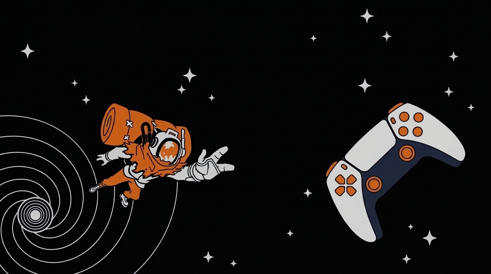

<p align="center"></p>
<p align="center"><sub>Автор логотипа: <a href="https://www.reddit.com/user/young_historic">u/young_historic</a></sub></p>

# OuterWilds-Dualsense

[English](README.md) | **Русский**

Мод DualSense для **Outer Wilds** (через [OWML](https://github.com/ow-mods/owml)): настоящий тактильный отклик через аудиоканалы контроллера, адаптивные триггеры, лайтбар по планетам, управление тачпадом и гироскопом.

> This work is unofficial Fan Content created under permission from the Mobius Digital Fan Content Policy. It includes materials which are the property of Mobius Digital and it is neither approved nor endorsed by Mobius Digital.
>
> *(Перевод: эта работа является неофициальным фанатским контентом, созданным по разрешению в рамках Fan Content Policy Mobius Digital. Она содержит материалы, принадлежащие Mobius Digital, и не одобрена и не поддерживается Mobius Digital.)*

## Возможности

- **Тактильный отклик**: почти любой ощутимый звук игры превращается в хаптику: реактивный ранец и двигатели корабля, шаги, прыжки и приземления, удары и урон, опасные зоны, вода, механизмы, двери и лифты, окружение планет и многое другое. Охвачены вся Солнечная система и DLC **Echoes of the Eye**. Музыка не используется, кроме сигналов сигналоскопа.
- **Адаптивные триггеры**: реактивный ранец, корабль (покой и тяга) и некоторые особые ситуации игры. Выключаются в меню, на загрузке, во сне и пока жаришь маршмеллоу, а также при автопилоте.
- **Лайтбар** в цвете планеты, на которой вы находитесь (цвета настраиваются).
- **Тачпад** как ввод: перемещение, вращение и масштаб карты; в бортжурнале — перемещение и масштаб карты и листание длинных записей; нажатие открывает запись в режиме слухов. Подсказки на экране с иконками кнопок PS5.
- **Гироскоп (экспериментальная функция, по умолчанию выключен)**: наклоняйте геймпад, чтобы управлять креном (и тангажем, рысканием) корабля и реактивного ранца в невесомости. **L3 + R3** — перекалибровка. Функция экспериментальная: управление может ощущаться неточным, «уплывать» или вести себя неожиданно, и работает только пока игра считает контроллер активным устройством ввода.
- **Меню настройки (F1)**: сила, тон и цвет каждого эффекта с кнопкой **Play**, чтобы ощутить его. Значения сохраняются в `effects.json`.
- Хаптика затихает на паузе и когда вы играете на клавиатуре и мыши.

## Требования

- Windows, Outer Wilds (Steam), [OWML](https://github.com/ow-mods/owml) 2.16.2.
- **DualSense**, подключённый по **USB**. Bluetooth не поддерживается (его формат отчёта не реализован).
- Для хаптики контроллер должен быть виден в Windows как аудиоустройство («Динамики (DualSense Wireless Controller)»). Мод находит его сам.

## Установка

1. Скачайте `Blightyboi.OuterWilds-Dualsense.zip` из [последнего релиза](../../releases/latest).
2. Распакуйте в папку `Mods` OWML так, чтобы получилось `Mods/Blightyboi.OuterWilds-Dualsense/DualSenseMod.dll` (рядом `manifest.json`).
3. Запустите игру через OWML (OWML Mod Manager или `OWML.Launcher.exe`).

## Настройки

Настройки → Mods → OuterWilds-Dualsense:

| Настройка | Что делает |
|---|---|
| `adaptiveTriggers` | адаптивные триггеры вкл/выкл |
| `lightbar` | лайтбар по планетам |
| `audioHaptics` | тактильный отклик вкл/выкл |
| `gyroMode` | **экспериментально**; `Off` (по умолчанию), `Full` (крен, тангаж, рыскание) или `Roll only` |
| `debugMenu` | разрешает меню настройки F1 |
| `debugLog` | подробный лог (для сообщений об ошибках) |

Силу каждого эффекта задают в меню F1 (см. ниже).

## Меню F1

Включите `debugMenu` в настройках мода и нажмите **F1** в игре. Откройте группу, меняйте числа или выбирайте цвет пипеткой, нажимайте **Play**, чтобы почувствовать эффект в идущей игре. Значения хранятся в `effects.json` в папке мода; удалите файл, чтобы вернуть значения по умолчанию.

## Если что-то не работает

- *Хаптики нет, а триггеры работают:* аудиоустройство контроллера отсутствует или выключено в Windows (проверьте настройки звука, кабель USB и порт). После переподключения мод открывает вывод заново сам.
- *Не работает ничего:* убедитесь, что контроллер подключён по USB, а не по Bluetooth. Если для игры включён Steam Input, попробуйте выключить его для Outer Wilds (он может скрывать контроллер от мода).
- *Слишком слабо или слишком сильно:* настройте эффект в меню F1 (силу каждого эффекта; «Master gain» в группе звуков двигателей меняет все хаптики сразу).
- В сообщении об ошибке приложите лог OWML и, по возможности, включите `debugLog`.

## Сборка из исходников

В репозитории только собственный код мода. Он собирается против сборок игры и OWML, которых в репозитории нет (они принадлежат их владельцам), поэтому на машине должна быть Outer Wilds с установленным OWML.

**Что нужно**

- Windows и копия Outer Wilds (Steam) с [OWML](https://github.com/ow-mods/owml), установленным через его установщик. Установщик кладёт `OWML.*.dll`, `0Harmony.dll` и пропатченный `Assembly-CSharp.dll` в `OuterWilds_Data/Managed`; проект берёт их оттуда.
- [.NET SDK](https://dotnet.microsoft.com/download) (6.0 или новее; проект собирается под .NET Framework 4.8 и берёт сборки ссылок из NuGet, поэтому первой сборке нужен интернет).
- Git.

**Шаги**

1. Клонируйте репозиторий: `git clone https://github.com/Blightyboi/OuterWilds-Dualsense.git`.
2. Укажите проекту, где игра и папка модов OWML. В `OuterWilds-Dualsense/OuterWilds-Dualsense.csproj` по умолчанию стоят пути автора (`GameManaged` и `ModsDir` в первом `PropertyGroup`). Либо поправьте их, либо передайте свои в командной строке (пути с пробелами в кавычках):

```bash
dotnet build OuterWilds-Dualsense -c Release -p:GameManaged="C:\Games\Outer Wilds\OuterWilds_Data\Managed" -p:ModsDir="C:\OWML\Mods\Blightyboi.OuterWilds-Dualsense"
```

3. Если пути уже исправлены в файле проекта, достаточно `dotnet build OuterWilds-Dualsense -c Release`.
4. После успешной сборки проект копирует `DualSenseMod.dll`, `DualSenseMod.pdb`, `manifest.json` и `default-config.json` в `ModsDir`, так что игру можно сразу запускать через OWML. Сами результаты сборки лежат ещё и в `OuterWilds-Dualsense/bin/Release/net48/`.

**Архив для релиза**

Упакуйте в zip папку `Blightyboi.OuterWilds-Dualsense`, в которой лежат `DualSenseMod.dll`, `manifest.json`, `default-config.json` и `LICENSE`. Свои `config.json` и `effects.json` в архив класть не нужно (это ваши локальные настройки). Внутри архива пути должны быть с прямыми слэшами (7-Zip и `zip` так и делают; `Compress-Archive` в Windows PowerShell 5.1 нет).

**Частые проблемы**

- *«Не удалось найти тип или имя пространства имён ...»* (`UnityEngine`, `OWML`, `Assembly-CSharp`): `GameManaged` указывает не на ту папку или OWML не установлен в этой копии игры.
- *Ошибка восстановления пакетов при первой сборке:* не скачался NuGet-пакет `Microsoft.NETFramework.ReferenceAssemblies`; проверьте соединение.
- *Игра не загружает новую сборку:* убедитесь, что `ModsDir` это папка, которую читает OWML (`<OWML>/Mods/Blightyboi.OuterWilds-Dualsense`), и что игра перезапущена.
- Если делаете форк мода, поменяйте `uniqueName` и `author` в `manifest.json`, чтобы не конфликтовать с оригиналом.

## Лицензия

[MIT](LICENSE). Outer Wilds — торговая марка своих владельцев; проект только читает звуки и состояние из запущенной игры.
